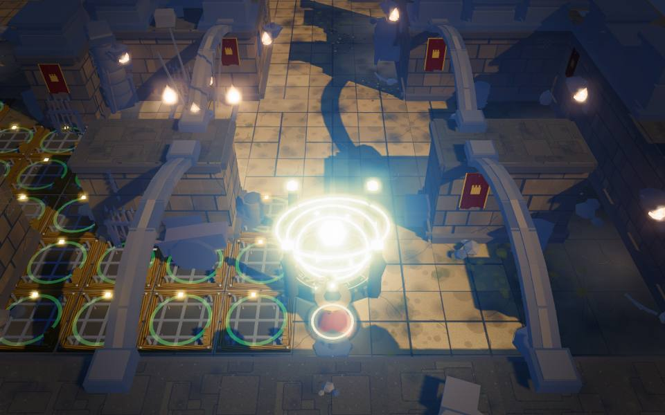
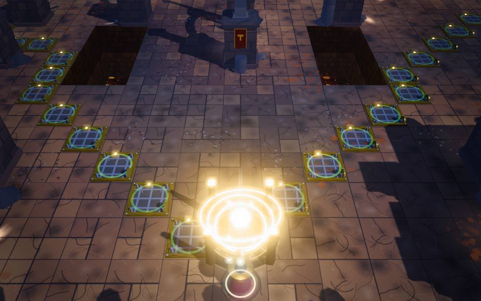
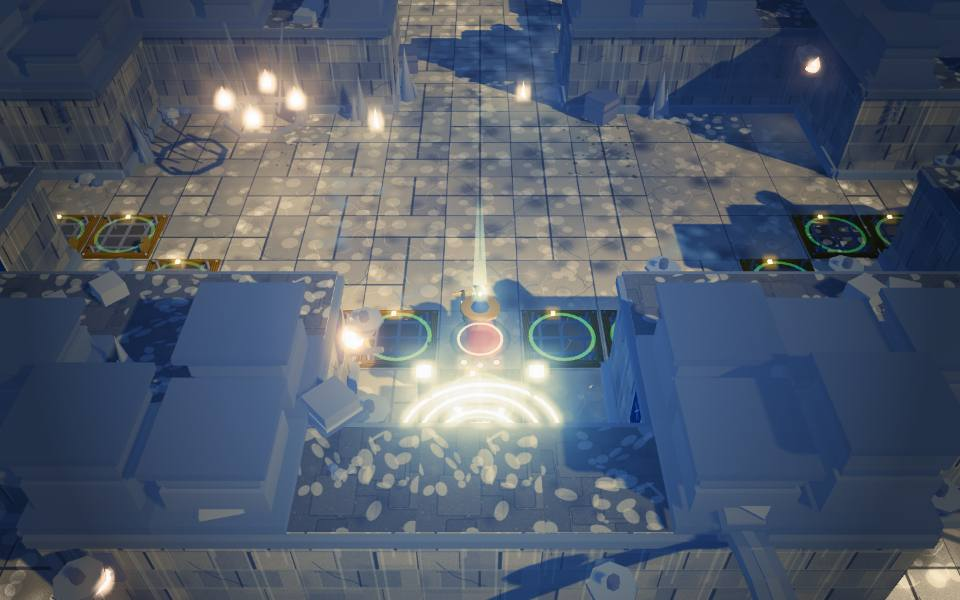
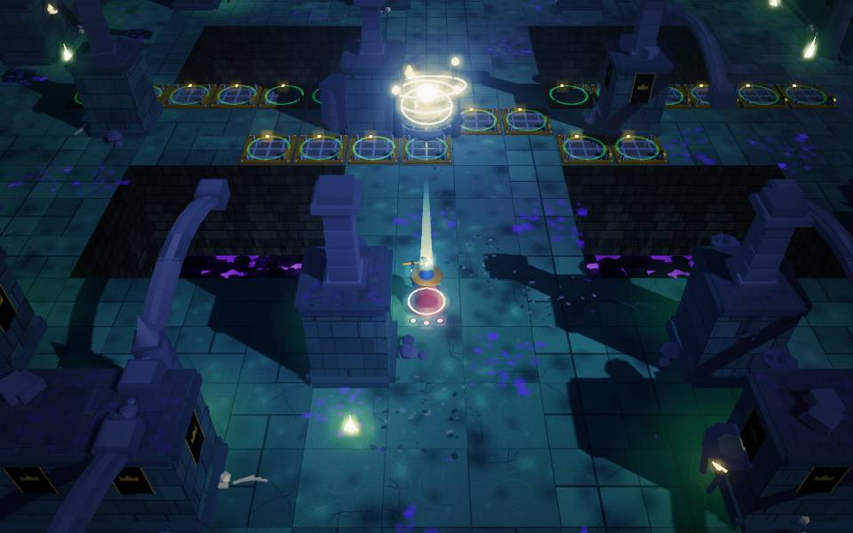
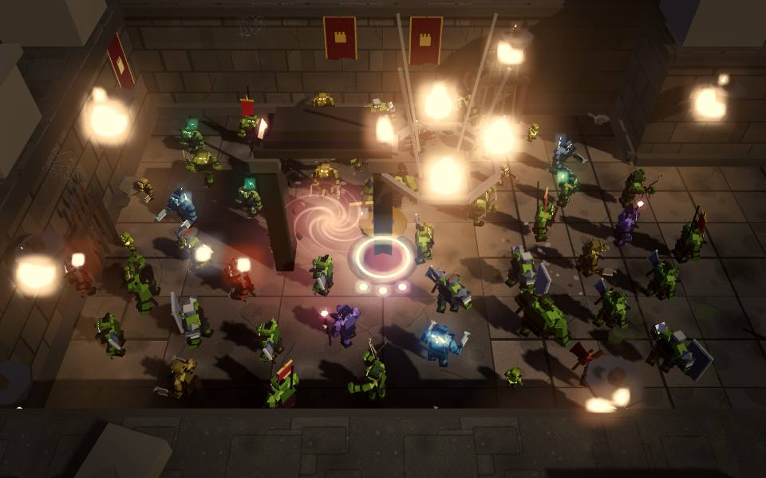

# Tower of Orcs

A top-down 3D action tower-defense built with Three.js. You are a war mage defending a
rift inside a castle. Between waves you build a killbox; during waves you fight in it.



| | |
|---|---|
|  |  |
|  |  |


## Run it

```bash
npm install
npm run dev
```

Then open **http://127.0.0.1:5173/**

Run the unit tests (damage, saves, grid/flow, camera collision, scoring, spellbook) with:

```bash
npm test
```

The third-person camera follows the mage's position without rotating when movement changes.
WASD moves relative to the camera and turns the mage toward travel, including backward and
diagonal movement. Hold the middle mouse button and drag horizontally to orbit and aim,
or use the controller's right stick. Attacks follow the mage's facing; holding middle mouse
aims toward the camera's forward direction. The mouse wheel adjusts distance, and `[` / `]` adjust camera tilt.
In build mode the camera keeps its heading while the cursor selects trap placement.

## Controls

| Input | Action |
|---|---|
| `WASD` | Move and face travel direction, relative to the camera |
| Middle-mouse drag | Orbit camera and aim; hold to face camera-forward |
| Mouse | Position traps in build mode |
| `LMB` | Fire / place trap in build mode |
| `RMB` | Melee / sell trap in build mode |
| `Space` | Dodge roll (i-frames) |
| `Tab` | Toggle build mode |
| `1`–`9` | Select trap |
| `R` | Rotate trap (build mode) / reload (otherwise) |
| `Q` / `Shift`+wheel | Swap weapon |
| `F` / `C` / `V` | Spells: Frost Nova / Blink / Arcane Lance |
| Wheel / `Alt`+wheel | Camera distance / camera tilt |
| `M` | Toggle the map |
| `Enter` | Start the next wave |
| `Esc` | Pause |

Every key above except the menu keys can be rebound under **Settings → Controls**. The game
pauses itself when the window loses focus (toggle in Settings).

### Controller

| Button | Action |
|---|---|
| Left stick / right stick | Move / orbit camera and aim |
| `RT` / `LT` | Fire / melee (place / sell in build mode) |
| `A` | Dodge roll |
| `X` | Reload |
| `Y` | Toggle build mode |
| `LB` / `RB` | Rotate trap / swap weapon |
| D-pad left / right | Previous / next trap |
| `Back` (View) | Start the next wave |
| `Start` | Pause |

## The loop

Waves are **player-triggered** — there is no forced countdown. Deliberating is the genre's
whole point, so the game never rushes you; starting early is rewarded instead.

Every orc archetype is a question and every trap is an answer:

| The problem | The answer |
|---|---|
| Ironhide orcs shrug off arrows | Crush damage — ceiling pounders |
| Gargoyles fly over your floor | Wall traps, ceiling traps, guardians |
| Sappers eat the front row of traps | Layer defences instead of stacking one row |
| Cinder orcs walk through brimstone | Anything that isn't fire |
| Shieldbearers block the front | Flank them, or crush through |
| Trolls regenerate | Keep them burning |

## Architecture

`ARCHITECTURE.md` is the contract every module is written against — coordinate system,
event names, the damage funnel, the enemy and trap definitions, and the performance budget.
Read it before changing anything.

```
src/
  core/       renderer, frame loop, camera rig, input, audio, pooling, save, debug
  shared/     event bus, damage funnel, RNG, scratch vectors
  world/      grid, flow-field pathing, level geometry, the 10 arenas, the rift
  entities/
    enemies/  17 orc archetypes, AI, procedural models, pooled manager
    player/   the war mage, weapons, spells
  traps/      16 traps across floor/wall/ceiling/guardian surfaces, build mode
  director/   wave composition, difficulty, scoring and the combo multiplier
  fx/         GPU particles, decals, gore, damage numbers, screen effects
  ui/         HUD, menus, level select, results
```

## Debug / automation API

The game exposes `window.dbg` for driving it without playing it — used heavily during
development to verify behaviour against real rendered frames rather than assumptions.

```js
dbg.load(3)                      // load a level
dbg.coin(300000)                 // grant currency
dbg.placeTrap('spike-floor', 12, 4)
dbg.autoBuild('spike-floor', 40) // fill every legal tile
dbg.stress(250)                  // flood the map with orcs
dbg.startWave()
dbg.step(600)                    // advance 600 frames, rendering each one
dbg.until(g => g.state === 'victory')
dbg.snapshot()                   // fps, draw calls, kills, leaks, rift hp, ...
dbg.validate()                   // check all 10 levels for bad ids / malformed maps
await dbg.save('name')           // write the current rendered frame to shots/name.jpg
```

`dbg.step()` drives the engine manually, so the game can be verified in environments where
`requestAnimationFrame` never fires. `dbg.save()` POSTs the frame to a dev-server endpoint
that writes it to `shots/` — which is how every visual change in this project was reviewed:
by looking at the actual pixels.
